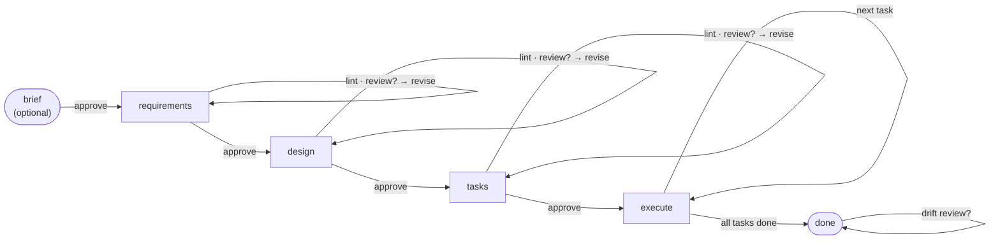

<p align="center">
  
</p>

<h1 align="center">steno spec</h1>

<p align="center">
  <a href="https://www.npmjs.com/package/steno-spec"></a>
  <a href="https://marketplace.visualstudio.com/items?itemName=rzndwb.steno-vscode"></a>
  <a href="https://paseo.sh/plugins/rizanw/steno"></a>
  <a href="https://github.com/rizanw/steno-spec/actions/workflows/ci.yml"></a>
  <a href="LICENSE"></a>
</p>

<p align="center">
  <strong>Shorthand specs for any coding agent.</strong><br>
  Plan a feature before you build it: requirements, then design, then tasks, then code. steno checks
  each stage and waits for your approval before the next one starts. It works with Claude Code, Codex,
  Antigravity, Cursor, Copilot, Gemini CLI, OpenCode and Kiro, and it keeps the token bill small.
</p>

<p align="center">
  <a href="#quick-start">Quick start</a> ·
  <a href="examples/link-shortener/TUTORIAL.md">Tutorial</a> ·
  <a href="docs/getting-started.md">Getting started</a> ·
  <a href="docs/concepts.md">Concepts</a> ·
  <a href="docs/cli.md">CLI reference</a> ·
  <a href="docs/agents.md">Agents &amp; integrations</a> ·
  <a href="packages/vscode/README.md">VS Code extension</a> ·
  <a href="packages/paseo/README.md">Paseo plugin</a>
</p>

---

Your agent does the writing and steno does the checking. The `steno` command has no model in it. It
creates the spec files, lints them, traces every task back to a requirement, and hands your agent only
what the current task needs. The thinking stays with the agent you already use.

- **Specs are plain Markdown.** `requirements.md`, `design.md` and `tasks.md`, with EARS criteria and
  stable IDs, so any agent can read and write them.
- **A task gets a packet, not the whole spec.** `steno ctx T1.1` gives the agent the criteria, terms,
  design sections and files for that one task. That is usually a few hundred tokens.
- **Reviews start fresh.** `steno-review` runs read-only reviewers that see the document and nothing
  of your conversation.
- **You can follow along in your editor.** The [plugins](#plugins) show where each spec stands, list
  the lint findings and give you the approvals.

## See it in action

You talk to your agent, and the `steno-*` skills run the CLI for you:

```text
you   > start a spec for link expiry: a link can be given an expiry time, after which
        it no longer redirects

agent > steno new link-expiry              → explores the code, outlines 5 requirements,
        steno lint requirements            → writes EARS criteria, fixes lint, asks you to approve

you   > approved. write the design

agent > steno approve requirements         → design.md, every section traced to criteria

you   > approved. break it into tasks

agent > steno approve design               → tasks.md with _Requirements:_ / _Design:_ footers

you   > do the next task

agent > steno next                         → T2.1 Accept expiresAt in LinkService.create
        steno ctx T2.1                     → reads one packet, implements, runs tests
        steno done T2.1                    → next: T2.2
```

Here is the same CLI run by hand on the finished spec in [examples/link-shortener](./examples/link-shortener):


The packet is what keeps it cheap. For `T2.1`, this is all the agent reads (shortened here; run
`steno ctx T2.1` in the example to see the whole packet):

```md
# T2.1 Accept `expiresAt` in `LinkService.create`, store it only when given
(part of T2 Service rules)

## Requirements
R1.1 WHEN a Link_Creator creates a Link with an Expiry_Time later than the current time, THE Shortener SHALL create the Link with that Expiry_Time.
R1.2 WHEN a Link_Creator creates a Link without an Expiry_Time, THE Shortener SHALL create a Link that never expires.

## Terms
Expiry_Time: the moment, chosen by the Link_Creator at creation, from which a Link no longer redirects.

## Design
### Create with expiry {#D-create}
_Satisfies: 1.1, 1.2, 3.1_
- Files: `src/links.ts`, `src/server.ts`
- `LinkService.create` calls `parseExpiry(input.expiresAt, clock())` and stores the result on the link (1.1).

## Likely files
src/links.ts
test/links.test.ts

## When finished
steno done T2.1
```

That spec is real. You can read it, and the code it produced, in [examples/link-shortener](examples/link-shortener).

## Quick start

You need Node 22 or later, on macOS, Linux or Windows. The npm package is called `steno-spec`, and the
command it installs is `steno`:

```bash
npm install -g steno-spec
```

Then set up your project, naming the agents you use:

```bash
steno init --agent claude,codex,opencode
```

Want to look around first? `npx steno-spec init --agent claude` sets up a project without installing
anything. Install the CLI before you hand work to your agent, though, because the skills call `steno`
directly.

You can name any of `claude, codex, opencode, antigravity, cursor, copilot, gemini, kiro`
([details](docs/agents.md)). Then open your agent and ask:

```text
> generate steering                       # once per project
> start a spec for <the feature you want>
```

The [tutorial](examples/link-shortener/TUTORIAL.md) builds a feature on the example project in about
half an hour. [Getting started](docs/getting-started.md) walks through every step, including quick
mode, bugfix specs and brainstorming.

## The workflow


<!-- npm-text
```text
brief?  →  requirements  →  design     →  tasks      →  execute      →  done
approve    ↺ lint           ↺ lint        ↺ lint        ↺ next task     drift review?
           ↺ review?        ↺ review?     ↺ review?
           approve →        approve →     approve →

↺ sends you back to revise the same stage; only approve moves to the next one.
```
-->

Every stage has a skill that writes it and a gate that ends it. When lint or a review finds a problem,
the document goes back for another pass. Reviews are optional, whenever you want one. Nothing moves to
the next stage until you approve it.

| Phase | Say to your agent | Skill | CLI underneath |
|---|---|---|---|
| Steering *(once per project)* | "generate steering" | `steno-steer` | `steno steer scan`, `steno steer new --all`, `steno steer lint` |
| 0. Brief *(optional)* | "brainstorm this idea first" | `steno-brainstorm` | `steno new --brief`; EGM `egm-brainstorm` on request |
| 1. Requirements | "start a spec for …" | `steno-spec` | `steno new`, `steno lint requirements` |
| 2. Design | "write the design" | `steno-design` | `steno approve requirements`, `steno lint design` |
| 3. Tasks | "break it into tasks" | `steno-tasks` | `steno approve design`, `steno lint tasks`, `steno trace` |
| 4. Execute | "do the next task" | `steno-run` | `steno next`, `steno ctx`, `steno done` |
| Review *(any time)* | "review the design" | `steno-review` | `steno review --stage …`; EGM `egm-review` with `reviewer: egm` |

Running `steno new` yourself only gives you an empty template. Ask your agent instead: it explores the
code, outlines the requirements, writes the criteria, fixes the lint and hands the result back to you.

`steno lint` catches what a careful reviewer would: a missing SHALL, vague words, undefined terms,
implementation detail in requirements, and requirements that no design section or task covers.

## Plugins

Your agent writes the spec. A plugin lets you see where every spec stands, read the lint findings and
approve each stage without leaving your editor.

| Plugin | Install |
|---|---|
| [VS Code](packages/vscode/README.md) | `code --install-extension rzndwb.steno-vscode` |
| [Paseo](packages/paseo/README.md) | `paseo plugin install npm:steno-paseo` |
| [Orca](docs/orca.md) | `orca plugin catalog add rizanw/steno-spec`, then `orca plugin install rizanw.steno` |

All three plugins let you approve a phase, tick a task off or reopen it, and hand
writing, reviewing or a task to an agent. When you hand work over, the agent gets a short skill call
such as `/steno-run T2.1 link-expiry` and never the contents of your files. The VS Code extension is on
Open VSX too, so it also installs in Cursor, Windsurf and VSCodium.

None of the plugins has a model or talks to the network, and each one brings its own copy of steno.
In Paseo and Orca, your agents run the `steno` on their own `PATH`, so install the CLI there as well.

## Build on steno

Building another editor integration or a script? You don't have to parse the Markdown yourself.

- **`steno lsp`** is a language server over stdio. It gives you diagnostics, document symbols and task
  lenses, plus requests for the spec tree, a task packet, approvals and task state.
- **`--json`** on the commands a client needs returns the same shapes as the server.

Both follow one versioned [JSON contract](docs/json-contract.md). Within a protocol version it only
grows, so what you build today keeps working.

## Docs

- [Tutorial](examples/link-shortener/TUTORIAL.md): build a feature on the example project
- [Getting started](docs/getting-started.md): install, a first spec from start to finish, quick mode, bugfixes
- [Concepts](docs/concepts.md): phases and gates, IDs, EARS, lint rules, context packets, steering
- [CLI reference](docs/cli.md): every command and flag
- [Agents & integrations](docs/agents.md): supported agents, VS Code, Paseo, Orca, EGM, coming from Kiro
- [VS Code extension](packages/vscode/README.md): the sidebar, approvals, handing work to your agent
- [Paseo plugin](packages/paseo/README.md): the steno panel in Paseo, approvals, handing work to an agent
- [Orca plugin](docs/orca.md): the steno panel in Orca, approvals, handing work to an agent
- [JSON contract](docs/json-contract.md): every shape `steno lsp` and `--json` return
- [Why steno](docs/why.md): how it compares with Kiro, Spec Kit and EGM, and where the token savings come from
- [Contributing](CONTRIBUTING.md): building from source, tests, commit messages, design principles

## License

[MIT](LICENSE)
