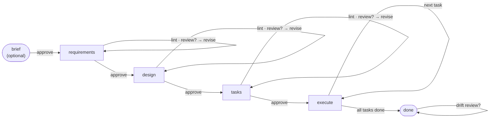

# Concepts

## The split: agent writes, CLI checks

steno has no model inside. Everything deterministic lives in the CLI and costs zero tokens: scaffolding, validation, traceability, task state, and assembling context. Everything that needs judgment lives in the agent, driven by seven short skills:

| Skill | Phase | Job |
|---|---|---|
| `steno-steer` | once per project | write the steering files every spec and task packet starts from |
| `steno-brainstorm` | brief | stress-test a rough idea, save `brief.md` |
| `steno-spec` | requirements | intake, explore code, outline, EARS criteria, lint, hand over |
| `steno-design` | design | one traced section per component or concern |
| `steno-tasks` | tasks | ordered, numbered tasks with footers back to requirements and design |
| `steno-run` | execute | next task → packet → implement → done, one at a time |
| `steno-review` | any | zero-history review of a stage, or drift after shipping |

Skills never name a harness's tools. They say "run `steno next`" or "ask the user", so the same file works in every agent.

The same checks reach your editor. `steno lsp` is a language server built on the same code as the commands, and the [VS Code extension](../packages/vscode/README.md) uses it to show the spec tree, the lint findings and the task packets. Both return exactly what the commands return, as described in the [JSON contract](json-contract.md).

## Phases and gates



Every gated stage ends the same way. The first two steps loop back to the same document until it is right; only the third moves forward:

1. **Lint.** `steno lint <stage>` checks the file mechanically: EARS form, undefined terms, criteria with no design or task, leftover template text. Errors block approval.
2. **Review (optional).** `steno-review` hands a packet with only that document to reviewers that have not seen your conversation. Lint finds what a rule can find; review finds contradictions, gaps and vague outcomes. Use it before approving anything you would not want to redo. A review is one full round and at most one verify round. Reviewers may rewrite or question what is there, but anything that would add to the spec or change its scope comes to you as a question first, and it has passed when no high finding is open and every question has an answer.
3. **Approve.** You say yes, and `steno approve <stage>` records it and opens the next stage. You can also approve from the tree in the VS Code extension. The agent never approves on its own.

After the last task, a drift review compares the finished code with the spec.

A spec's phase lives in `spec.yaml`. Through the gated stages only an approval moves it forward, and only when `steno lint` has no errors for that file (unless `steno approve --force`). Finishing the last task moves the spec from execute to done, and reopening a task moves it back. A done spec that gets new, unticked tasks in `tasks.md` counts as in execute again, and `steno reopen` moves a done spec back before you write them.
Approving writes nothing; the next file's skeleton is written by `steno scaffold` when its phase skill starts, so a file exists only once the phase has begun, and the agent still never starts from a blank page.

Two modes:

- **gated** (`steno new`): one file at a time, a human approves each.
- **quick** (`steno quick`): all three files at once, straight to execute. For small, well-understood changes.

Two kinds:

- **feature**: `requirements.md`
- **bugfix** (`--bugfix`): `bugfix.md` with Current / Expected / Unchanged Behavior sections, then
  requirements as usual.

## Stable IDs

IDs are derived from the documents, so agents can reference instead of re-quoting:

| ID | Comes from | Example |
|---|---|---|
| `R1` | `### Requirement 1: …` | a requirement |
| `R1.2` | the 2nd numbered acceptance criterion of R1 | a criterion |
| `D-auth` | a design heading tagged `{#D-auth}` | a design section |
| `T2`, `T2.1` | `- [ ] 2.` / `- [ ] 2.1` in tasks.md | a task and sub-task |

`steno show <id>` prints one item. `steno show requirements|design|tasks` prints an outline.
Agents are told to fetch by ID and never read a whole spec file.

## The file format

The layout is compatible with Kiro specs, with one addition: design headings can carry `{#D-id}` and a `_Satisfies:_` footer.

**requirements.md**

```md
# Requirements Document

## Introduction
## Glossary
- **Auth_Service**: issues and refreshes sessions.

## Requirements
### Requirement 1: Login with email
**User Story:** As a user, I want to log in with email, so that I can access my account.
#### Acceptance Criteria
1. WHEN a user submits valid credentials, THE Auth_Service SHALL create a session.
2. IF the password is wrong, THEN THE Auth_Service SHALL return a generic error.
```

**design.md**

```md
# Design — Email login
## Overview
## Architecture {#D-arch}
## Components and Interfaces
### AuthService {#D-auth}
_Satisfies: 1.1, 1.2_
- Responsibility: …
- File: `src/auth/service.ts`
## Data Models
## Error Handling
## Testing Strategy
```

**tasks.md**

```md
# Tasks — Email login
- [ ] 1. Session model and store
  - [ ] 1.1 Add Session entity and migration
    - _Requirements: 1.1_  _Design: D-auth_
  - [ ]* 1.2 Property test for token refresh        ← `*` marks an optional task
    - _Requirements: 1.3_
- [ ] 2. Login endpoint
```

The `R` prefix in footers is optional: `1.1` and `R1.1` mean the same thing.

## EARS acceptance criteria

Every criterion follows one of the EARS patterns, so it reads as a testable statement:

| Pattern | Shape |
|---|---|
| Event | WHEN `<trigger>`, THE `<Component>` SHALL `<response>`. |
| Unwanted | IF `<condition>`, THEN THE `<Component>` SHALL `<response>`. |
| State | WHILE `<state>`, THE `<Component>` SHALL `<response>`. |
| Optional | WHERE `<feature or mode>`, THE `<Component>` SHALL `<response>`. |
| Ubiquitous | THE `<Component>` SHALL `<response>`. |

Components are `Glossary_Terms`, defined once in the Glossary and used verbatim in criteria.

## Lint rules

`steno lint [requirements|design|tasks]` exits with code 2 on errors. Errors block `approve`; warnings do not.

**Every document**

| Rule | Level | Catches |
|---|---|---|
| `spec/missing` | error | the stage's file does not exist yet |
| `spec/placeholder` | error | template lines with `<…>` are still there: the file is the skeleton, not yet written |
| `spec/empty-section` | warn | a heading with nothing under it (no text, no sub-heading); for example `## Open questions` after the last question is settled |

**requirements.md**

| Rule | Level | Catches |
|---|---|---|
| `req/empty` | error | no `### Requirement N:` headings |
| `req/dup-id` | error | two requirements with the same number |
| `req/no-criteria` | error | a requirement with no acceptance criteria |
| `ears/shall` | error | a criterion with no SHALL |
| `req/title`, `req/story` | warn | missing title or `**User Story:**` |
| `req/too-many-criteria` | warn | a requirement with more than 12 criteria |
| `req/too-large` | warn | more than 60 criteria in one spec: it probably holds more than one deliverable |
| `ears/shall-case` | warn | `shall` in lower case |
| `ears/pattern` | warn | criterion does not start with WHEN / IF / WHILE / WHERE / THE |
| `ears/split` | warn | more than one SHALL in one criterion |
| `ears/undefined-term` | warn | a `Term_Name` that is not in the Glossary |
| `ears/too-long` | warn | more than 35 words |
| `ears/vague` | warn | fast, easy, intuitive, appropriate, robust, seamless, etc. |
| `ears/implementation` | warn | file paths, function calls, camelCase identifiers, JSX in a requirement |

**design.md**

| Rule | Level | Catches |
|---|---|---|
| `design/empty`, `design/dup-id` | error | no sections, duplicate `{#D-id}` |
| `design/unknown-req` | error | `_Satisfies:_` names a requirement or criterion that does not exist |
| `design/over-tagged` | warn | one section claims more than 6 criteria |
| `design/footer-on-overview` | warn | Overview, Testing Strategy or Open Questions carries a `_Satisfies:_` footer |
| `design/overlap` | warn | one criterion is claimed by more than 3 sections |
| `design/uncovered-req` | warn | a requirement no section satisfies |

**tasks.md**

| Rule | Level | Catches |
|---|---|---|
| `tasks/empty`, `tasks/dup-id`, `tasks/orphan` | error | no tasks, duplicate numbers, sub-task without a parent |
| `tasks/unknown-req`, `tasks/unknown-design` | error | a footer references something that does not exist |
| `tasks/no-req` | warn | a leaf task with no `_Requirements:_` footer |
| `tasks/uncovered-req` | warn | a requirement with no task |

`steno trace --criteria` goes one level finer and flags criteria that are on no task, or spread across more than two.

Steering files and `.steno/config.yaml` have their own rules (`steering/*`, `config/*`), listed under [`steno steer lint`](cli.md#steno-steer-lint).

## Context packets

`steno ctx <task>` builds the only thing an agent reads to implement a task:

1. the task line, its parent and its siblings
2. the acceptance criteria the task references, and only those
3. the Glossary terms those criteria use
4. the design sections the task references, in two tiers: the **primary** section (the first `_Design:_` reference) is kept whole and cut last; **secondary** sections are filtered to the lines that mention the task's criteria
5. likely files: paths in backticks from the task and its design sections, marked `(new)` when they do not exist yet
6. steering files whose pattern matches those files
7. the command to run when finished

The packet is trimmed to a token budget (`ctxBudget` in config, 1500 by default, or `--budget`).
Anything trimmed is named in the header so the agent can fetch it with `steno show`.

## Steering

Optional project-wide context in `.steno/steering/*.md`, in a format compatible with Kiro's steering files: the core three run 1.5–4 KB each, every line a specific fact; topic files 0.5–1.5 KB. Specific beats short: a 300-byte keyword list briefs nobody, and `steno steer lint` says so.

```md
---
inclusion: fileMatch
fileMatchPattern: "src/api/**"
---
All API handlers return problem+json errors. Use the shared `withAuth` wrapper.
```

| `inclusion` | Enters a packet when |
|---|---|
| `always` (or no frontmatter) | every task |
| `fileMatch` | one of the task's likely files matches `fileMatchPattern` |
| `manual` | never automatically; fetch it with `steno show steering/<file>` |

`fileMatchPattern` takes one glob, a comma list, or a brace group. Paths with glob characters (`app/(auth)`) are written as `app/[(]auth[)]`.

### Generating steering

Writing `product.md`, `tech.md` and `structure.md` is split the same way as everything else in steno: the CLI fingerprints the repo, the agent writes the prose.

1. `steno steer scan` reads manifests and folder names (never source) and suggests files. The core three are `always`; topic files such as `database.md`, `api.md`, `auth.md`, `i18n.md`, `ui.md`, `testing.md`, `infra.md`, `ci.md`, `messaging.md` and `domain.md` appear only when the repo shows evidence, each with a `fileMatchPattern` derived from the folders found and a short `read:` list. A topic with only one or two files behind it is marked weak and offered, not written, so a lone `vercel.json` does not earn an `infra.md`.
2. `steno steer new --all` writes skeletons with topic headings (`database.md` has Engine and client, Tables, Schema conventions, Migrations, Invariants, Query patterns, Seeds and test data).
3. `steno steer schema` prints the tables, columns and foreign keys from the SQL migrations, Prisma or Drizzle schema, or SQLAlchemy models in a compact one-line-per-table form; `database.md` carries it so data tasks see the real schema without reading migrations.
4. The `steno-steer` skill reads only the `read:` list, fills each file with facts, and runs `steno steer lint`.

On an empty folder the scan reports greenfield and the skill stops instead of inventing a product and a stack; brainstorm or write the first spec, then generate steering once code exists.

`always` files are read in full when a spec starts and head-truncated in task packets, so they cost little per task; `steno steer lint` still fails when they exceed `steeringBudget` together, and warns when a file is too thin (`steering/thin`), has the wrong shape (`steering/shape`:
`structure.md` needs a tree or table, `tech.md` a command block) or packs several facts into one bullet (`steering/packed`). Put domain rules in the topic file where they apply, not in `product.md`.

## State and change tracking

`spec.yaml` is owned by the CLI: phase, mode, kind and approval dates.
`steno status` keeps a hash of each file in `.steno/cache/` (local, never committed) and tells the agent
which files changed since it last looked, so it re-reads only what moved. `steno status --json` reads the hashes without updating them. Task state lives in the checkboxes of `tasks.md`; `steno next` finds the next one so nobody re-reads the list.

## Configuration

`.steno/config.yaml`:

```yaml
specsDir: .steno/specs   # set to .kiro/specs to share specs with Kiro
steeringDir: .steno/steering   # set to .kiro/steering to share steering with Kiro
ctxBudget: 1500          # tokens per `steno ctx` packet
steeringBudget: 4000     # cap for all `inclusion: always` steering together (Kiro's three ≈ 1900; 2% of a 200k window)
reviewer: default        # default | egm: steno's own reviewers, or hand reviews to EGM when it is installed
agents:                  # written by `steno init`
  - claude
  - codex
```
