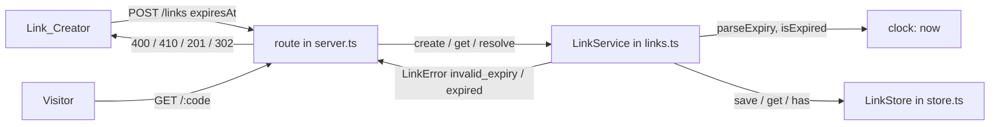

# Design — Link expiry

## Overview
A link gains one optional stored field, `expiresAt`. Whether a link is expired is never stored: it is computed from `expiresAt` and the current time on every call, so nothing has to run when the deadline passes. All rules stay in `src/links.ts`; `src/server.ts` only passes the new input through, shows the new fields, and maps two new error kinds to statuses. `LinkService` receives a clock so tests can move time without waiting.

## Architecture {#D-arch}

- `src/main.ts` is unchanged: it builds `LinkService` with the default clock.
- Dependency direction is unchanged: `server.ts` → `links.ts` → `store.ts`.

## Components and Interfaces
### Expiry input parsing {#D-expiry-input}
_Satisfies: 1.3, 1.4_
- Responsibility: turn the raw `expiresAt` input into a stored value or a `LinkError`.
- File: `src/links.ts`
- Interface:
```ts
export function parseExpiry(raw: unknown, now: Date): string | undefined;
```
- Behaviour:
  - `undefined` input returns `undefined` (no expiry).
  - Input must be a string in ISO 8601 date-time form ending in `Z` or a `±hh:mm` offset, and must parse to a real date; otherwise it throws `invalid_expiry` (1.3).
  - A parsed time equal to or earlier than `now` throws `invalid_expiry` (1.4).
  - The returned value is the UTC form from `toISOString()`, so stored values compare consistently.
- Rejected: accepting any string `Date.parse` understands, because it accepts local times with no zone.

### Clock and expiry check {#D-is-expired}
_Satisfies: 2.5, 5.2, 5.4_
- Responsibility: one place that answers "is this link expired right now".
- File: `src/links.ts`
- Interface:
```ts
export type Clock = () => Date;
export function isExpired(link: Link, now: Date): boolean;
// LinkService constructor gains an optional second argument:
constructor(store: LinkStore, clock: Clock = () => new Date())
```
- Behaviour:
  - `isExpired` is true when `link.expiresAt` is set and is equal to or earlier than `now`.
  - It is evaluated on each call from the clock, with no timer and no background job (2.5).
  - After a restart the same check runs against the loaded `expiresAt`, so a deadline that passed while the process was down is honoured (5.2).
  - Expiry writes nothing: `clicks` and `createdAt` are untouched because no save happens when a link expires (5.4).
- `createdAt` in `create` also takes its value from the clock.

### Create with expiry {#D-create}
_Satisfies: 1.1, 1.2, 3.1_
- Responsibility: accept the optional expiry on creation.
- Files: `src/links.ts`, `src/server.ts`
- Interface:
```ts
export interface CreateLinkInput { url: string; code?: string; expiresAt?: unknown }
```
- Behaviour:
  - `LinkService.create` calls `parseExpiry(input.expiresAt, clock())` after URL and code validation and stores the result on the link (1.1).
  - With no `expiresAt` the stored link has no `expiresAt` field at all (1.2).
  - `route` in `src/server.ts` passes `body.expiresAt` through unchanged; the `201` body comes from `present`, which includes `expiresAt` when set (3.1).

### Follow a link {#D-resolve}
_Satisfies: 2.1, 2.2, 2.3_
- Responsibility: refuse to redirect an expired link.
- File: `src/links.ts`
- Behaviour:
  - `LinkService.resolve` loads the link, then checks `isExpired` before counting.
  - Not expired: adds one click, saves, returns the URL as today (2.1).
  - Expired: throws `LinkError('expired', …)` before any change, so no redirect is sent (2.2) and `clicks` is not saved (2.3).

### Inspect a link {#D-inspect}
_Satisfies: 3.2, 3.3, 3.4, 3.5_
- Responsibility: show expiry state without treating expiry as an error.
- Files: `src/links.ts`, `src/server.ts`
- Interface:
```ts
export type LinkView = Link & { expired: boolean };
// LinkService.create and LinkService.get return LinkView
```
- Behaviour:
  - `LinkService.get` returns the link plus `expired`, computed with `isExpired`; it never throws `expired` (3.4, 3.5).
  - `expiresAt` appears in the JSON only when the link has one (3.2, 3.3).
  - `present` in `src/server.ts` takes a `LinkView` and still only adds `shortUrl`; the router does not compute `expired` itself.
  - `resolve` uses a private lookup that returns the plain `Link`, so `expired` is never written to the store.

### Code reservation {#D-code-reservation}
_Satisfies: 4.1, 4.2, 4.3, 4.4_
- Responsibility: keep an expired link's code taken until the link is deleted.
- File: `src/links.ts`
- Behaviour:
  - `checkCustomCode` and `freshCode` keep using `store.has(code)`, which knows nothing about expiry, so an expired link still blocks its code (4.1, 4.2).
  - `LinkService.remove` is unchanged and does not check expiry (4.3); once it deletes the link, `store.has` is false and the code can be created again (4.4).
- No code change is expected here; the criteria are pinned by new tests so a later clean-up feature cannot break them silently.

## Data Models {#D-data}
_Satisfies: 5.1, 5.3_
| Field | Source | Used by |
|---|---|---|
| `Link.expiresAt?: string` | `parseExpiry` result; UTC ISO 8601; absent means never expires | `isExpired`, `present`, `FileStore` |
| `LinkView.expired: boolean` | computed by `LinkService`; never stored | `POST /links` and `GET /links/:code` responses |

- `src/store.ts`: only the `Link` interface changes. `FileStore` already writes and reloads whole `Link` objects, so `expiresAt` persists with no further change (5.1).
- A link saved before this feature has no `expiresAt` key; `isExpired` treats a missing value as never expiring, so no migration is needed (5.3).

## Correctness Properties
### Property 1: Expiry is a pure function of the stored time and the clock {#D-prop-1}
_Validates: 2.5_
*For any* link and any time `t`, `isExpired(link, t)` is true exactly when the link has an `expiresAt` and `expiresAt ≤ t`.

### Property 2: Visits to an expired link never change it {#D-prop-2}
_Validates: 2.3_
*For any* expired link and any number of `resolve` calls, the stored link is identical before and after.

### Property 3: Rejected expiry input creates nothing {#D-prop-3}
_Validates: 1.3, 1.4_
*For any* `expiresAt` that is not a zoned ISO 8601 time later than now, `create` throws `invalid_expiry` and the store holds the same links as before.

## Error Handling {#D-errors}
_Satisfies: 2.4, 2.2, 1.3, 1.4_
- `LinkErrorKind` in `src/links.ts` gains `invalid_expiry` and `expired`.
- `STATUS` in `src/server.ts` maps `invalid_expiry` → 400 and `expired` → 410. The `Record<LinkErrorKind, number>` type fails the type check until both are added.
- Expired visit → `410` with `{ "error": "expired", "message": … }`; an unknown code stays `404 not_found` (2.4).
- Invalid or past `expiresAt` → `400` with `{ "error": "invalid_expiry", "message": … }`; the message says a future ISO 8601 time with a time zone is required.

## Testing Strategy
| Criteria | Test type | File |
|---|---|---|
| 1.1–1.4, Property 3 | unit, fixed clock | `test/links.test.ts` |
| 2.1–2.3, 2.5, Properties 1–2 | unit, clock advanced between calls | `test/links.test.ts` |
| 3.2–3.5 | unit on `LinkService.get` | `test/links.test.ts` |
| 4.1–4.4 | unit, expired link then create / remove / create | `test/links.test.ts` |
| 2.4, 3.1, 1.3 status and body shape | HTTP, app built with a controllable clock | `test/server.test.ts` |
| 5.1–5.3 | unit, `FileStore` on a temp file, reload with a later clock; a file written without `expiresAt` | `test/store.test.ts` (new) |
| 5.4 | unit, compare link before and after the clock passes `expiresAt` | `test/links.test.ts` |

Properties are written as table-driven cases with `node:test`; no property-testing library is added, because the project allows no new dependencies.
