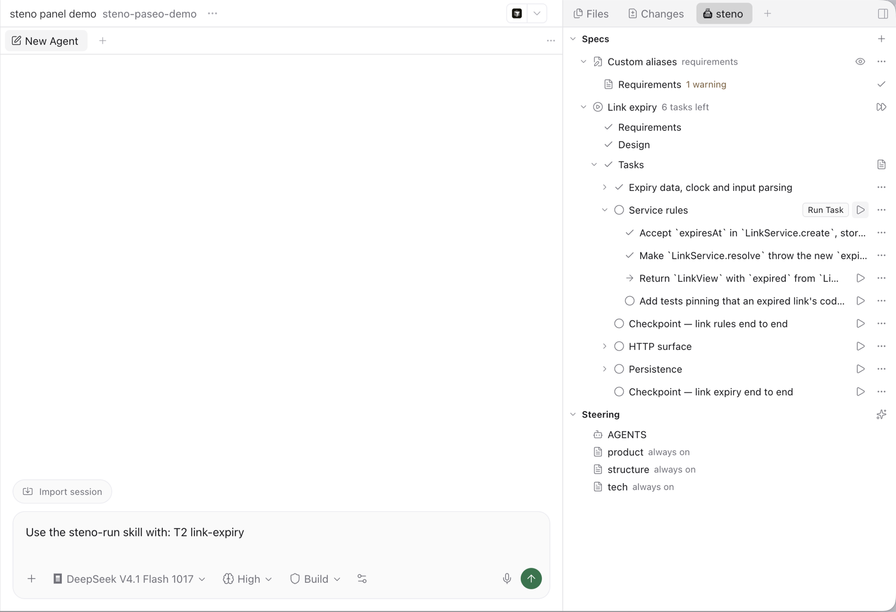

<p align="center">
  
</p>

<h1 align="center">steno spec for Paseo</h1>

<p align="center">
  <a href="https://www.npmjs.com/package/steno-paseo"></a>
  <a href="https://paseo.sh/plugins/rizanw/steno"></a>
  <a href="https://github.com/rizanw/steno-spec/actions/workflows/ci.yml"></a>
  <a href="https://github.com/rizanw/steno-spec/blob/main/LICENSE"></a>
</p>

<p align="center">
  <strong>Shorthand specs for any coding agent.</strong><br>
  Plan a feature before you build it: requirements, then design, then tasks, then code. Your agent
  writes each stage in Paseo, and the steno panel shows where every spec stands, lists each lint
  problem and gives you the approvals. It has no model in it and spends no tokens.
</p>

<p align="center">
  <a href="#quick-start">Quick start</a> ·
  <a href="#use-it">Use it</a> ·
  <a href="#troubleshooting">Troubleshooting</a> ·
  <a href="https://github.com/rizanw/steno-spec/blob/main/docs/getting-started.md">Getting started</a> ·
  <a href="https://github.com/rizanw/steno-spec/blob/main/docs/concepts.md">Concepts</a> ·
  <a href="https://github.com/rizanw/steno-spec/blob/main/docs/cli.md">CLI reference</a>
</p>

<p align="center">
  
</p>

---

- **Specs are plain Markdown.** `requirements.md`, `design.md` and `tasks.md`, with EARS criteria and
  stable IDs, so whichever agent you run in Paseo can do the writing while you watch.
- **Every stage has a gate.** Lint errors send a document back for another pass, and only your
  approval moves a spec on.
- **A task gets a packet, not the whole spec.** Your agent reads `steno ctx T2.1`, usually a few
  hundred tokens. The panel, the lint problems and the approvals cost nothing.
- **It brings everything it needs.** The plugin carries its own steno language server and skills and
  runs them on Paseo's Node. There is no second runtime to install and no network call.

## Quick start

You need **Paseo 0.16 or later** with plugins turned on (Settings → Plugins → Enable plugins), and
npm on the Paseo daemon's `PATH`.

```bash
paseo plugin install npm:steno-paseo
paseo plugin ls                        # steno shows "running"
```

The panel works on its own. Your agents are another matter: they call `steno` from their skills, and
they use the daemon's `PATH`, so install the CLI where the daemon can find it:

```bash
npm install -g steno-spec
```

If the `steno` on that `PATH` is missing, older than the plugin's copy or speaks a different protocol,
the panel shows a warning bar with the exact command to install the right version.

Then open a workspace and pick the **steno** tab in the Explorer. If the folder has no `.steno/` yet,
choose **Set Up steno** and pick the coding agents that should get the steno skills.

## The workflow

```text
brief?  →  requirements  →  design     →  tasks      →  execute      →  done
approve    ↺ lint           ↺ lint        ↺ lint        ↺ next task     drift review?
           ↺ review?        ↺ review?     ↺ review?
           approve →        approve →     approve →

↺ sends you back to revise the same stage; only approve moves to the next one.
```

Every stage has a skill that writes it and a gate that ends it. A review is there whenever you want
one: read-only reviewers look at the document and never see your conversation. Only you can approve.
No skill and no agent can do it for you.

## Use it

| You want to | Do this |
|---|---|
| See your specs | Expand a spec to see its documents and tasks. The next task is marked. |
| Read a document | Tap it. Its lint problems are listed above the text. Documents open read-only, because your agent is the one who edits them. |
| Move a spec on | Tap **Approve** on the document of the current phase. If lint finds an error, the approval is refused and the problems are listed. |
| Tick off a task | Tap **Mark Done** on the task. **Reopen** asks you before it changes anything. |
| Add work to a finished spec | Choose **Reopen Spec** from the spec's "more" menu, then add tasks to `tasks.md`. A finished spec that already has new, unticked tasks is back in execution without it. |
| Hand work to an agent | Tap **Run Task**, **Run Next Task**, **Write**, **Review** or **Revise** (Write becomes Revise once the document is written). The skill call lands unsent in the agent you have open, or else in an open New Agent screen, or else in your most recent agent. With no agent at all, it is copied to the clipboard. |
| Start something new | Tap **New Spec** on the Specs header, or **Generate Steering** on the Steering header. |
| Set up a folder | Tap **Set Up steno** on a folder without `.steno/`, and choose which coding agents get the skills. |

Every action is in the Command Center too. Press ⌘K (Ctrl+K on Windows and Linux) and type `steno`. An
item such as **Approve…** opens the panel with a list of everything it applies to.

When a row has more actions than fit as buttons, the rest are behind its **more** button (•••).

## Update and uninstall

| To | Run |
|---|---|
| Update | `paseo plugin update steno` |
| Turn it off for a while | `paseo plugin disable steno` (and `enable` to bring it back) |
| Uninstall | `paseo plugin remove steno` |

The plugin unpacks its programs into `~/.paseo/plugin-data/steno/`, one folder per version. Removing
the plugin leaves that folder behind, so delete it by hand if you want the space back.

## Troubleshooting

Start with the plugin's log:

```bash
paseo plugin logs steno
```

A healthy start has one line for the unpacked programs and one for each program that started:

```text
steno: programs in ~/.paseo/plugin-data/steno/<hash>/vendor
steno: cli started: <version>
steno: language server started: <name> <version>
```

| You see | What to do |
|---|---|
| steno is missing from `paseo plugin ls` | Turn plugins on in Settings → Plugins, then install it again. |
| `cli failed` or `language server failed` in the log | Run `paseo plugin update steno`, then `paseo plugin reload steno`. If it keeps happening, [open an issue](https://github.com/rizanw/steno-spec/issues) and attach the log. |
| `could not unpack the bundled programs` | Make sure `~/.paseo/plugin-data/` is writable. |
| A warning bar naming `npm install -g steno-spec@<version>` | Your agents' `steno` is missing, older than the plugin's or speaks a different protocol. Run that command on the machine where the daemon runs. |
| The panel says the steno server stopped | It crashed five times in a row. Choose **Restart steno Server**, and check the log if it stops again. |
| The install fails on `npm:` | npm must be on the daemon's `PATH` and able to reach the npm registry. |

## Docs

- [Getting started](https://github.com/rizanw/steno-spec/blob/main/docs/getting-started.md): a first spec from start to finish, quick mode, bugfixes
- [Concepts](https://github.com/rizanw/steno-spec/blob/main/docs/concepts.md): phases and gates, IDs, EARS, lint rules, context packets, steering
- [CLI reference](https://github.com/rizanw/steno-spec/blob/main/docs/cli.md): every command and flag
- [Agents & integrations](https://github.com/rizanw/steno-spec/blob/main/docs/agents.md): supported agents and reviewers
- [Contributing](https://github.com/rizanw/steno-spec/blob/main/CONTRIBUTING.md#the-paseo-plugin): build the plugin from source and test it

## License

[MIT](https://github.com/rizanw/steno-spec/blob/main/LICENSE)
